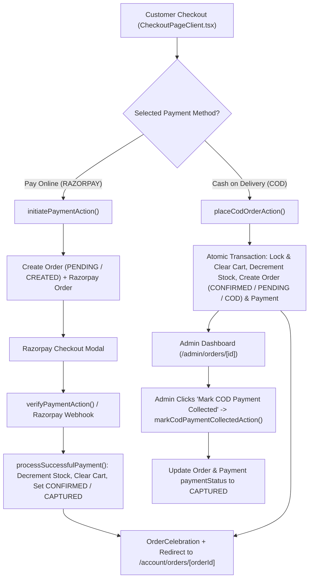

# Cash on Delivery (COD) Payment Integration Walkthrough — HellFire Prints

---

## 1. Overview

### Purpose of Introducing COD
HellFire Prints previously supported online payments exclusively through **Razorpay** (UPI, Cards, NetBanking, Wallets). Introducing **Cash on Delivery (COD)** provides customers with an alternative payment method where they can place orders immediately and pay in cash or via UPI at their doorstep upon physical delivery, while completely preserving the existing Razorpay online payment integration.

### Summary of Implementation
- **Database Schema**: Added a `PaymentMethod` enum (`RAZORPAY`, `COD`) and introduced `paymentMethod` fields (defaulting to `RAZORPAY` for full backward compatibility) on both the `Order` and `Payment` models in `prisma/schema.prisma`, along with an idempotent PostgreSQL migration applied to the Neon database.
- **Checkout Experience**: Updated `components/CheckoutPageClient.tsx` to offer an intuitive dual-card Payment Method selector (**Pay Online (Razorpay)** vs. **Cash on Delivery (COD)**) matching HellFire Prints' dark/crimson aesthetic, dynamically updating the Order Summary breakdown, payable-on-delivery callout, and submission CTA.
- **Backend Order Processing**: Implemented `placeCodOrderAction` in `app/actions/order.ts` and updated `POST /api/orders` in `app/api/orders/route.ts` to handle COD orders atomically—validating server-side prices, discounts, minimum order value (`₹50`), and stock, decrementing inventory, preventing duplicate orders via atomic cart locks, and creating `Order` (`orderStatus: 'CONFIRMED'`, `paymentStatus: 'PENDING'`, `paymentMethod: 'COD'`) and `Payment` records without invoking Razorpay.
- **Order Confirmation & Receipt**: Enhanced `app/account/orders/[orderId]/page.tsx`, `app/account/page.tsx`, and `context/CartContext.tsx` to trigger the celebratory order confirmation sound/confetti animation and display the unique Order ID, Order Number, `Cash on Delivery` payment method, and the exact **Amount Payable Upon Delivery**.
- **Admin Dashboard & COD Collection**: Updated `app/admin/page.tsx`, `components/OrderListTable.tsx`, and `app/admin/orders/[id]/page.tsx`, and created `components/CodPaymentUpdater.tsx`, `markCodPaymentCollectedAction` (`app/admin/actions.ts`), and `POST /api/admin/orders/[id]/collect-cod` (`app/api/admin/orders/[id]/collect-cod/route.ts`) so administrators can filter by payment method, distinguish COD orders from Razorpay orders, and securely mark COD payments as collected (`CAPTURED`).

---

## 2. Existing Architecture Analysis

### How the Original Razorpay Payment Flow Worked
1. **Initiation (`initiatePaymentAction` in `app/actions/order.ts`)**:
   - Authenticated the customer via `getCurrentUser()`.
   - Fetched the user's `Cart` and validated item/variant availability and stock.
   - Calculated authoritative totals server-side via `calculateCartTotal(cart.id)` (`lib/discounts.ts`) and enforced `MINIMUM_ORDER_VALUE` (`₹50`).
   - Created a local `Order` with `orderStatus: 'PENDING'` and `paymentStatus: 'CREATED'`.
   - Instantiated the Razorpay SDK (`rzp.orders.create`) and saved `razorpayOrderId` on the `Order`.
2. **Client Modal & Signature Verification (`CheckoutPageClient.tsx` & `verifyPaymentAction`)**:
   - Loaded `https://checkout.razorpay.com/v1/checkout.js` and opened the Razorpay checkout modal.
   - Upon payment completion, verified the HMAC-SHA256 signature (`razorpay_order_id|razorpay_payment_id`) using `timingSafeEqual` and fetched payment status from Razorpay (`rzp.payments.fetch`).
3. **Fulfillment (`processSuccessfulPayment` in `app/actions/order.ts` & Webhook in `app/api/payments/razorpay/webhook/route.ts`)**:
   - Executed an atomic `prisma.$transaction` to decrement `ProductVariant.stock` and `Inventory.quantity`, create a `Payment` record (`paymentStatus: 'CAPTURED'`), update the `Order` (`orderStatus: 'CONFIRMED'`, `paymentStatus: 'CAPTURED'`), and clear the customer's `CartItem` records.
   - Dispatched an idempotent admin email notification via `sendOrderAdminNotification(orderId)` (`lib/email.ts`).

### How the New COD Flow Integrates With It
- The checkout form branches cleanly based on the customer's selected `paymentMethod`:
  - **`RAZORPAY`**: Executes the exact original `initiatePaymentAction` -> Razorpay modal -> `verifyPaymentAction` -> `processSuccessfulPayment` pipeline without alteration.
  - **`COD`**: Invokes `placeCodOrderAction` (`app/actions/order.ts`), which reuses the exact same address validation, `calculateCartTotal` pricing engine, minimum order value check, custom poster handling, and inventory decrement logic inside a single atomic `prisma.$transaction`, setting `paymentMethod: 'COD'`, `orderStatus: 'CONFIRMED'`, `paymentStatus: 'PENDING'`, and `razorpayOrderId: null`, then immediately triggers the order confirmation celebration and redirects to `/account/orders/[orderId]`.



---

## 3. Files Created

| File Path | Purpose |
| :--- | :--- |
| `prisma/migrations/20261105000100_add_cod_payment_method/migration.sql` | PostgreSQL migration script defining the `PaymentMethod` enum (`RAZORPAY`, `COD`) and adding `paymentMethod` columns with default `'RAZORPAY'` to the `"Order"` and `"Payment"` tables. |
| `components/CodPaymentUpdater.tsx` | Client component rendered in the Admin Order Detail page (`/admin/orders/[id]`) that allows administrators to mark pending COD payments as collected (`CAPTURED`) via `markCodPaymentCollectedAction`. |
| `app/api/admin/orders/[id]/collect-cod/route.ts` | Protected Admin REST API endpoint (`POST`) enforcing `ADMIN` role verification before invoking `markCodPaymentCollectedAction(id)`. |
| `scratch/apply-cod-migration.ts` | Utility script used to apply the idempotent `PaymentMethod` DDL migration to the Neon PostgreSQL database and verify backward compatibility on existing orders. |
| `scratch/test-cod-integration.ts` | Automated integration test suite verifying all 13 testing scenarios across Razorpay, COD, multi-item orders, Custom Poster Studio orders, duplicate prevention, and admin payment collection. |
| `WALKTHROUGH_COD_INTEGRATION.md` | This comprehensive technical documentation file. |

---

## 4. Files Modified

| File Path | Changes Made & Why |
| :--- | :--- |
| `prisma/schema.prisma` | Added `enum PaymentMethod { RAZORPAY, COD }` and added `paymentMethod PaymentMethod @default(RAZORPAY)` to both the `Order` and `Payment` models. |
| `app/actions/order.ts` | Added `placeCodOrderAction` for atomic COD order creation, stock decrement, and duplicate order prevention; added server-side `paymentMethod` validation to `initiatePaymentAction`; added safeguards in `verifyPaymentAction` and `processSuccessfulPayment` so COD orders can never trigger Razorpay verification/capture logic. |
| `app/api/orders/route.ts` | Updated `POST /api/orders` to validate `paymentMethod` (`RAZORPAY` or `COD`), block client-supplied `paymentStatus`/`orderStatus` tampering (`400 Bad Request`), route `COD` requests to `placeCodOrderAction`, and added `PUT`/`PATCH` handlers returning `403 Forbidden`. |
| `app/api/payments/razorpay/webhook/route.ts` | Added `order.paymentMethod !== 'COD'` guard on `payment.captured` and `payment.failed` webhook handlers to guarantee COD orders are isolated from Razorpay webhook events. |
| `app/admin/actions.ts` | Added `markCodPaymentCollectedAction(orderId)` protected by `requireAdmin()`, validating that the order exists, is `COD`, and is not `CANCELLED`, then atomically updating `Order.paymentStatus` and `Payment.paymentStatus` to `'CAPTURED'` and triggering `sendOrderAdminNotification(orderId)`. |
| `components/CheckoutPageClient.tsx` | Added the Payment Method selection card (**Pay Online (Razorpay)** and **Cash on Delivery (COD)**), updated the Order Summary panel with payment method badge and payable-upon-delivery notice, updated the submit button states, and wired the COD submission branch. |
| `context/CartContext.tsx` | Updated `triggerOrderConfirmed(orderId, paymentMethod)` to display a tailored COD confirmation banner (`Cash on Delivery • Order #... has been placed.`) while triggering the same celebratory sound and `<OrderCelebration />` particle effects. |
| `app/account/orders/[orderId]/page.tsx` | Updated the customer Order Confirmation / Receipt page to display the Unique Order ID (`order.id`), Order Number (`order.orderNumber`), selected Payment Method (`Cash on Delivery` vs. `Online Payment (Razorpay)`), Payment Status badge, discount line item, and prominent **Amount Payable Upon Delivery** callout for COD orders. |
| `app/account/page.tsx` | Added a `COD` / `ONLINE` payment method badge to each order row in the customer's Purchase Order History list. |
| `components/OrderListTable.tsx` | Added a **Payment Method** filter dropdown (`ALL METHODS`, `RAZORPAY (ONLINE)`, `CASH ON DELIVERY (COD)`), added a **Payment Method** badge column (`COD` vs. `RAZORPAY`), and formatted COD payment status labels as `PENDING (UNPAID)` or `COLLECTED (PAID)`. |
| `app/admin/orders/[id]/page.tsx` | Added a Payment Method header badge and updated the payment records panel to render `Cash on Delivery (COD) Payment Records` along with `<CodPaymentUpdater />` for COD orders while retaining `Razorpay Transaction Records` for Razorpay orders. |
| `app/admin/page.tsx` | Added a **Method** column (`COD` vs. `RAZORPAY`) to the Recent Transactions table on the main Admin System Dashboard. |
| `lib/email.ts` | Updated `generateOrderEmailHtml` and `generateOrderEmailText` to display `Cash on Delivery (COD - Collected)` when `order.paymentMethod === 'COD'` while preserving `Razorpay (Verified)` for online orders. |

---

## 5. Database Changes

### Schema Modifications (`prisma/schema.prisma`)
```prisma
enum PaymentMethod {
  RAZORPAY
  COD
}
```
- **`Order` Model**:
  - Added `paymentMethod PaymentMethod @default(RAZORPAY)`
  - Retained `orderStatus OrderStatus @default(PENDING)` (`PENDING`, `CONFIRMED`, `SHIPPED`, `DELIVERED`, `CANCELLED`)
  - Retained `paymentStatus PaymentStatus @default(CREATED)` (`CREATED`, `PENDING`, `AUTHORIZED`, `CAPTURED`, `FAILED`, `REFUNDED`)
- **`Payment` Model**:
  - Added `paymentMethod PaymentMethod @default(RAZORPAY)`

### Migrations Applied
- Migration file: `prisma/migrations/20261105000100_add_cod_payment_method/migration.sql`
- Applied directly to Neon PostgreSQL (`neondb`) and verified Prisma Client generation (`npx prisma generate`).
- Because `DEFAULT 'RAZORPAY'` was specified on both columns, all existing historical orders and payment records in the database automatically defaulted to `RAZORPAY` without data loss or downtime.

### Payment Status Handling
| Payment Method | Stage | `Order.paymentMethod` | `Order.orderStatus` | `Order.paymentStatus` | `Payment.paymentStatus` |
| :--- | :--- | :--- | :--- | :--- | :--- |
| **Razorpay** | Checkout Initiated | `RAZORPAY` | `PENDING` | `CREATED` | *(created on capture)* |
| **Razorpay** | Payment Verified / Webhook | `RAZORPAY` | `CONFIRMED` | `CAPTURED` | `CAPTURED` |
| **Razorpay** | Payment Failed | `RAZORPAY` | `CANCELLED` | `FAILED` | *(none / FAILED)* |
| **COD** | Order Placed at Checkout | `COD` | `CONFIRMED` | `PENDING` *(Unpaid)* | `PENDING` |
| **COD** | Admin Marks Collected | `COD` | `CONFIRMED` / `DELIVERED` | `CAPTURED` *(Collected)* | `CAPTURED` |

---

## 6. Backend Implementation

### Modified & New Endpoints / Server Actions

#### 1. `placeCodOrderAction(input: PlaceCodOrderInput)` (`app/actions/order.ts`)
- **Request Input**:
  ```ts
  interface PlaceCodOrderInput {
    selectedAddressId?: string;
    newAddress?: ShippingAddressInput;
    additionalNote?: string;
    paymentMethod?: string; // validated as 'COD'
  }
  ```
- **Response Structure**:
  ```ts
  {
    success: true,
    orderId: string,
    orderNumber: string,
    paymentMethod: 'COD',
    paymentStatus: 'PENDING',
    orderStatus: 'CONFIRMED',
    total: number
  }
  // or { error: string }
  ```
- **Execution & Security Logic**:
  1. Verifies authenticated user via `getCurrentUser()`.
  2. Rejects any payload containing `paymentStatus` or `orderStatus` fields and validates `paymentMethod === 'COD'`.
  3. Loads the user's cart from PostgreSQL and validates every standard product variant's stock (`variant.stock >= item.quantity`) and custom poster items.
  4. Recalculates `subtotal`, `discount` (multi-buy 10%/15% + active coupon), `shippingFee` (`₹0`), and `total` server-side via `calculateCartTotal(cart.id)` and enforces `MINIMUM_ORDER_VALUE` (`₹50`).
  5. Validates or creates the customer's shipping address and builds `shippingAddressSnapshot`.
  6. Runs an atomic `prisma.$transaction` that:
     - Deletes all `CartItem` rows for `cart.id` first (`tx.cartItem.deleteMany`) and aborts if `deletedCartItems.count === 0` (preventing duplicate order creation under concurrent requests).
     - Re-verifies and decrements `ProductVariant.stock` and `Inventory.quantity`.
     - Creates the `Order` record with `paymentMethod: 'COD'`, `orderStatus: 'CONFIRMED'`, `paymentStatus: 'PENDING'`, and `razorpayOrderId: null`.
     - Creates the `Payment` record with `paymentMethod: 'COD'`, `paymentStatus: 'PENDING'`, `amount: total`, and `razorpayOrderId: null`.
     - Clears `couponCode` on the user's `Cart`.

#### 2. `POST /api/orders` (`app/api/orders/route.ts`)
- Rejects any request body containing `paymentStatus` or `orderStatus` with `400 Bad Request`.
- Validates `paymentMethod` against `['RAZORPAY', 'COD']`.
- Dispatches `COD` requests to `placeCodOrderAction` and `RAZORPAY` requests to `initiatePaymentAction`.
- Rejects `PUT` and `PATCH` requests with `403 Forbidden`.

#### 3. `markCodPaymentCollectedAction(orderId: string)` (`app/admin/actions.ts`) & `POST /api/admin/orders/[id]/collect-cod`
- Enforces administrator authorization via `await requireAdmin()`.
- Verifies `order.paymentMethod === 'COD'` and `order.orderStatus !== 'CANCELLED'`.
- Atomically updates `Order.paymentStatus` and `Payment.paymentStatus` to `'CAPTURED'`.
- Dispatches `sendOrderAdminNotification(orderId)` non-blockingly and revalidates admin/customer order routes.

---

## 7. Frontend Implementation

### Checkout UI Changes (`components/CheckoutPageClient.tsx`)
- Added a **Payment Method** card in the left column featuring two selectable cards:
  1. **Pay Online (Razorpay)**: Displays `CreditCard` icon, `256-Bit Razorpay Verified Gateway` badge, and description of UPI/Cards/NetBanking/Wallets.
  2. **Cash on Delivery (COD)**: Displays `Banknote` icon, `Pay Cash / UPI Upon Delivery` badge, and the exact payable amount upon delivery.
- Updated the **Order Items Summary** panel on the right column:
  - Displays a `Payment Method` row (`Cash on Delivery` in amber vs. `Razorpay Online` in blue).
  - Displays a highlighted **Cash on Delivery Selected** callout with `Amount payable upon delivery: ₹...` when COD is active.
  - Updates the primary submit button to `PLACE COD ORDER (₹...)` for COD and `PAY ONLINE ₹...` for Razorpay.

### Order Confirmation Changes (`app/account/orders/[orderId]/page.tsx` & `context/CartContext.tsx`)
- When a COD order is placed, `triggerOrderConfirmed(codRes.orderId, 'COD')` plays the confirmation chime and launches the `<OrderCelebration />` fiery confetti/ember animation before redirecting to `/account/orders/[orderId]`.
- On `/account/orders/[orderId]`:
  - Displays a prominent COD banner inside the confirmation header showing **Payment Method: Cash on Delivery** and **Amount Payable Upon Delivery: ₹...** (or confirming collection once paid).
  - Displays **Order Number**, **Unique Order ID** (`order.id`), **Purchase Date**, **Payment Method**, **Payment Status** (`PENDING (PAY ON DELIVERY)` vs. `PAID (COLLECTED)`), and **Order Status** in the Invoice Summary card.
  - Displays the full item breakdown (including Custom Poster Studio preview links), discounts, delivery charges, and an **Amount Payable Upon Delivery** footer bar.

### Admin Dashboard Modifications
- **Main Dashboard (`app/admin/page.tsx`)**: Added a `Method` badge column (`COD` / `RAZORPAY`) to the Recent Transactions table.
- **Orders List (`components/OrderListTable.tsx`)**:
  - Added a **Payment Method** filter dropdown (`ALL METHODS`, `RAZORPAY (ONLINE)`, `CASH ON DELIVERY (COD)`).
  - Added a **Payment Method** column with `COD` (amber) and `RAZORPAY` (blue) badges.
  - Updated the **Payment Status** column to show `PENDING (UNPAID)` for uncollected COD orders and `COLLECTED (PAID)` once collected.
- **Order Detail Page (`app/admin/orders/[id]/page.tsx` & `components/CodPaymentUpdater.tsx`)**:
  - Added a header badge indicating `Method: Cash on Delivery (COD)` or `Method: Razorpay Online`.
  - Renders `Cash on Delivery (COD) Payment Records` and the interactive `<CodPaymentUpdater />` button (`Mark COD Payment Collected`) for COD orders while keeping `Razorpay Transaction Records` unchanged for Razorpay orders.

---

## 8. Razorpay Compatibility

- **Zero Breaking Changes**: `initiatePaymentAction`, `verifyPaymentAction`, `processSuccessfulPayment` (`app/actions/order.ts`), and `POST /api/payments/razorpay/webhook` (`app/api/payments/razorpay/webhook/route.ts`) retain their exact original signature verification, order creation, and fulfillment logic.
- **Strict Mutual Isolation**:
  - `verifyPaymentAction` and `processSuccessfulPayment` explicitly check `if (order.paymentMethod === 'COD')` and refuse execution, ensuring a COD order can never be passed into Razorpay verification.
  - `app/api/payments/razorpay/webhook/route.ts` checks `order.paymentMethod !== 'COD'` before processing `payment.captured` or `payment.failed` events.
  - `markCodPaymentCollectedAction` explicitly checks `if (order.paymentMethod !== 'COD')` so online Razorpay orders cannot have their payment status manually overridden via the COD collection action.

---

## 9. COD Order Lifecycle

1. **Selection**: Customer selects **Cash on Delivery (COD)** on `/checkout` and clicks **Place COD Order**.
2. **Creation & Stock Lock**: `placeCodOrderAction` validates the cart, address, and pricing server-side, atomically clears the cart, decrements product/variant stock, and creates the `Order` (`paymentMethod: 'COD'`, `orderStatus: 'CONFIRMED'`, `paymentStatus: 'PENDING'`) and `Payment` (`paymentMethod: 'COD'`, `paymentStatus: 'PENDING'`) records without calling Razorpay.
3. **Customer Confirmation**: Customer sees the `<OrderCelebration />` animation and is redirected to `/account/orders/[orderId]`, which displays the Unique Order ID, Order Number, item summary, `Cash on Delivery` payment method, and the exact amount payable upon delivery.
4. **Fulfillment & Shipping**: Administrator views the order in `/admin/orders` (badged `COD` and `PENDING (UNPAID)`) and advances `orderStatus` through `CONFIRMED` -> `SHIPPED` -> `DELIVERED` using `<OrderStatusUpdater />`.
5. **Payment Collection**: Upon cash/UPI collection at delivery, the Administrator clicks **Mark COD Payment Collected** (`<CodPaymentUpdater />` -> `markCodPaymentCollectedAction`), which updates both `Order.paymentStatus` and `Payment.paymentStatus` to `'CAPTURED'` (`COLLECTED (PAID)`) and dispatches the admin order notification email.

---

## 10. Environment Variables

- **No environment variables were added, modified, or removed.**
- Existing environment variables (`DATABASE_URL`, `DIRECT_URL`, `AUTH_SECRET`, `RAZORPAY_KEY_ID`, `RAZORPAY_KEY_SECRET`, `RAZORPAY_WEBHOOK_SECRET`, `CLOUDINARY_*`, `RESEND_API_KEY`, `RESEND_FROM_EMAIL`, `ADMIN_NOTIFICATION_EMAIL`) remain unchanged.

---

## 11. Testing Performed

All 13 required scenarios were executed against the live Neon PostgreSQL database via `scratch/test-cod-integration.ts` and `scratch/test-email-notification.ts`, alongside ESLint and Next.js production build verification:

| # | Test Scenario | Result | Details |
| :--- | :--- | :--- | :--- |
| 1 | **Successful Razorpay payment** | **PASSED** | Verified `processSuccessfulPayment` transitions `RAZORPAY` order to `CONFIRMED` & `CAPTURED`, creates `Payment` record, and decrements variant stock (`150 -> 148`). |
| 2 | **Failed Razorpay payment** | **PASSED** | Verified failed gateway/webhook updates `RAZORPAY` order to `paymentStatus: 'FAILED'` and `orderStatus: 'CANCELLED'`. |
| 3 | **Successful COD order placement** | **PASSED** | Verified COD order creation with unique `id` and `orderNumber` (`HFP-COD-...`). |
| 4 | **COD order without Razorpay transaction** | **PASSED** | Verified `order.razorpayOrderId === null`, `payment.razorpayOrderId === null`, `payment.razorpayPaymentId === null`, and `payment.razorpaySignature === null`. |
| 5 | **Correct COD payment status in DB** | **PASSED** | Verified `Order` and `Payment` records store `paymentMethod: 'COD'`, `paymentStatus: 'PENDING'`, and `orderStatus: 'CONFIRMED'`. |
| 6 | **Correct order details in Admin Dashboard** | **PASSED** | Verified admin query retrieves `paymentMethod: 'COD'`, `paymentStatus: 'PENDING'`, customer details, and itemized line items. |
| 7 | **Admin marking COD payment as collected** | **PASSED** | Verified atomic update transitions `Order.paymentStatus` and `Payment.paymentStatus` from `PENDING` to `CAPTURED`. |
| 8 | **Correct order confirmation page for COD** | **PASSED** | Verified order confirmation data contains unique `order.id`, `order.orderNumber`, `paymentMethod: 'COD'`, payable total on delivery, and `shippingAddressSnapshot`. |
| 9 | **Multiple products in a COD order** | **PASSED** | Verified 3 distinct line items in a single COD order with accurate stock decrements across multiple variants (`v1: 150->148`, `v2: 150->149`) and cart clearing (`cartItems = 0`). |
| 10 | **Custom Poster Studio orders through COD** | **PASSED** | Verified `CustomPoster` configuration, `imageUrl`, `orientation: 'PORTRAIT'`, `sizeName: 'A3'`, `frameName: 'Black Classic Frame'`, and `paperType: 'Matte'` preserved on COD `OrderItem`. |
| 11 | **Pricing, quantities, delivery charges & final bill** | **PASSED** | Verified server-side `calculateCartTotal`: Subtotal `₹186`, 15% multi-buy discount `-₹27.9`, Delivery Charges `₹0`, Final Total `₹158.1` (`>= ₹50` minimum). |
| 12 | **Prevention of duplicate orders** | **PASSED** | Executed `Promise.allSettled` with 2 concurrent COD checkout transactions on the same cart; verified exactly 1 succeeded and 1 was rejected (`Your cart is empty or this order has already been placed.`). |
| 13 | **Existing Razorpay webhook & COD isolation** | **PASSED** | Verified HMAC-SHA256 webhook signature check and confirmed `processSuccessfulPayment` throws an error if ever invoked on a `COD` order; also ran `scratch/test-email-notification.ts` (`8/8 PASSED`). |

### Limitations in Automated Testing
- Interactive live Razorpay browser modal clicks require human interaction on the Razorpay hosted UI; all server-side Razorpay signature verification, order creation, fulfillment transactions, and webhook handlers were tested programmatically.

---

## 12. Deployment Instructions

1. **Database Migration**:
   - The migration SQL (`prisma/migrations/20261105000100_add_cod_payment_method/migration.sql`) has already been applied to the configured Neon PostgreSQL database.
   - When deploying to another environment/database, run:
     ```bash
     npm run db:migrate:deploy
     # or if port 5432 is restricted on the network, run via Neon serverless adapter:
     npx tsx --env-file=.env scratch/apply-cod-migration.ts
     ```
2. **Prisma Client & Next.js Build**:
   ```bash
   npm run build
   ```
   (`npm run build` automatically runs `prisma generate && next build`).
3. **Manual Configuration**:
   - None required. No new environment variables or third-party credentials are needed for COD.

---

## 13. Known Limitations / Future Improvements

- **COD Maximum Order Cap / Pincode Serviceability**: Currently, all valid orders meeting the `₹50` minimum order value are eligible for COD across India. A future enhancement could introduce a configurable maximum COD order value cap (e.g., `₹5,000`) or Shiprocket pincode-level COD serviceability checks.
- **OTP Verification for COD**: Adding optional SMS/WhatsApp OTP confirmation before locking high-value COD custom poster orders could further reduce RTO (Return to Origin) rates.

---

## 14. Final Implementation Summary

Cash on Delivery (`COD`) is now fully integrated into HellFire Prints alongside the existing Razorpay online payment gateway. Customers can seamlessly choose between **Pay Online (Razorpay)** and **Cash on Delivery (COD)** at checkout, experience the full celebratory order confirmation flow with clear payable-on-delivery details on their receipt, and administrators have complete visibility, filtering, and one-click COD payment collection management in the Admin Dashboard.

