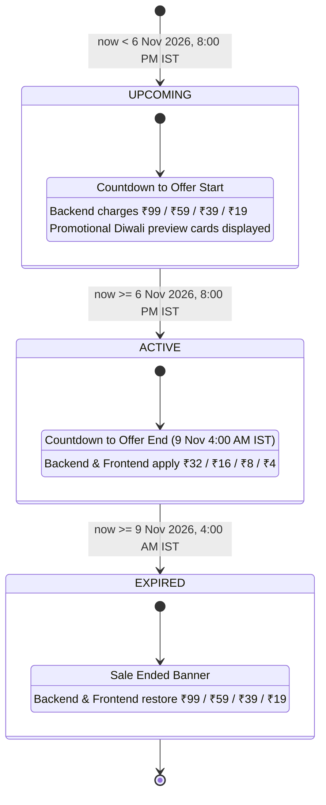

# HellFire Prints — The Grand Diwali Sale 2026 (`WALKTHROUGH_DIWALI_OFFER.md`)

---

## 1. Executive Summary

This document provides the complete architectural, visual, security, and verification walkthrough for the **HellFire Prints — Grand Diwali Festival Sale 2026** transformation.

The update transforms HellFire Prints into a futuristic, cyberpunk-meets-Indian-festival celebration of light while preserving 100% of the existing e-commerce architecture, original background layers, product catalogue, Custom Poster Studio, Razorpay online payment flow, Cash on Delivery (COD) flow, authentication, and historical orders.

### Key Highlights
- **Centralized Promotional Pricing (`lib/pricing.ts`)**:
  - **A3 Poster**: ~~₹99~~ → **₹32** (Save ₹67 • **68% OFF** • Badge: `DIWALI SPECIAL OFFER`)
  - **A4 Poster**: ~~₹59~~ → **₹16** (Save ₹43 • **73% OFF** • Badge: `FESTIVE BESTSELLER`)
  - **A5 Poster**: ~~₹39~~ → **₹8** (Save ₹31 • **79% OFF** • Badge: `FESTIVE PRICE`)
  - **A6 Poster**: ~~₹19~~ → **₹4** (Save ₹15 • **79% OFF** • Badge: `LIMITED-TIME OFFER`)
- **Authoritative Minimum Order Value (`₹30`)**:
  - Enforced across both frontend (`app/cart/page.tsx`, `components/CheckoutPageClient.tsx`) and backend (`lib/discounts.ts`, `app/actions/order.ts`) for both **Razorpay** and **Cash on Delivery (COD)**.
- **Strict IST Offer Validity Window (`Asia/Kolkata`, `UTC+05:30`)**:
  - **Offer Start**: `6 November 2026 — 8:00 PM IST` (`2026-11-06T20:00:00+05:30`)
  - **Offer End**: `9 November 2026 — 4:00 AM IST` (`2026-11-09T04:00:00+05:30`)
  - Live 1-second updating countdown timer (`DAYS : HOURS : MINUTES : SECONDS`), supporting `UPCOMING`, `ACTIVE`, and `EXPIRED` states with an interactive UI preview switcher for demonstration and testing.
- **Complete Festive UI Transformation**:
  - Original background (`components/HellfireBackground.tsx`) preserved 100% and enhanced with layered festive radial glows (Electric Gold `#FFD700`, Rich Saffron `#FF8C00`, Royal Violet `#7C3AED`, Cyber Blue `#0284C7`) and floating golden sparks.
  - Multi-stage HTML5 Canvas **Firecracker & Aerial Burst System** (`components/DiwaliFireworks.tsx`).
  - Handcrafted SVG **Glowing Diyas** (`<DiyaLamp />`, `<DiyaSectionDivider />`) and **Hanging Festive Jhalars** (`<FestiveJhalar />`) (`components/DiwaliDecorations.tsx`).

---

## 2. Diwali Promotional Pricing Structure

All poster pricing is governed by a single source of truth in `lib/pricing.ts`:

| Poster Size | Dimensions | Original Price | Diwali Festive Price | Customer Savings | Discount % | Promotional Badge |
| :--- | :--- | ---: | ---: | ---: | ---: | :--- |
| **A3** | `29.7 × 42 cm` | ~~₹99~~ | **₹32** | **Save ₹67** | **68% OFF** | `DIWALI SPECIAL OFFER` |
| **A4** | `21 × 29.7 cm` | ~~₹59~~ | **₹16** | **Save ₹43** | **73% OFF** | `FESTIVE BESTSELLER` |
| **A5** | `14.8 × 21 cm` | ~~₹39~~ | **₹8** | **Save ₹31** | **79% OFF** | `FESTIVE PRICE` |
| **A6** | `10.5 × 14.8 cm` | ~~₹19~~ | **₹4** | **Save ₹15** | **79% OFF** | `LIMITED-TIME OFFER` |

### Prominent Visual Presentation
- Every product card (`components/ProductCatalog.tsx`), product configurator (`components/ProductDetails.tsx`), Custom Poster Studio size selector (`app/custom-poster/page.tsx`), hero showcase (`components/DiwaliHeroSection.tsx`), cart item (`app/cart/page.tsx`), and checkout summary (`components/CheckoutPageClient.tsx`) displays:
  1. Visibly struck-through original price (`~~₹99~~`, `~~₹59~~`, `~~₹39~~`, `~~₹19~~`).
  2. Prominent electric-gold promotional price (`₹32`, `₹16`, `₹8`, `₹4`).
  3. Exact savings badge (`SAVE ₹67`, `SAVE ₹43`, `SAVE ₹31`, `SAVE ₹15`) and festive status pill (`DIWALI SALE`, `FESTIVE PRICE`, `LIMITED-TIME OFFER`).

---

## 3. Minimum Order Value Implementation

- **Constant Definition**: `export const MINIMUM_ORDER_VALUE = 30;` in `lib/pricing.ts`.
- **Dynamic Cart Progress & Shortfall Feedback (`app/cart/page.tsx`)**:
  - When the eligible cart subtotal is below `₹30` (for example, `1 × A4 = ₹16` during the Diwali Sale), the cart displays a warning alert:
    > *"Minimum order value is ₹30. Add ₹14 more to place your order."*
  - Includes a live golden progress bar tracking `subtotal / 30` and disables the `Checkout Now` button until `subtotal >= ₹30`.
  - Updating item quantities dynamically recalculates the subtotal and immediately unlocks checkout once `₹30` is reached (e.g., `2 × A4 = ₹32` or `1 × A3 = ₹32`).
- **Checkout Page Enforcement (`components/CheckoutPageClient.tsx`)**:
  - Displays a dedicated Minimum Order status badge (`Minimum Order (₹30) Satisfied — READY` or shortfall warning) and blocks form submission if the order total is below `₹30`.
- **Backend Enforcement (`app/actions/order.ts` & `lib/discounts.ts`)**:
  - Both `initiatePaymentAction` (Razorpay) and `placeCodOrderAction` (Cash on Delivery) recalculate item prices from the database using the server timestamp and reject any request where `finalAmount < 30` with:
    `Minimum order value is ₹30. Add ₹<shortfall> more to place your order.`

---

## 4. Offer Validity & Countdown Timer Architecture

### Authoritative IST Time Window
Defined in `lib/pricing.ts` using explicit ISO-8601 strings with the `Asia/Kolkata` (`+05:30`) offset:
- `DIWALI_OFFER_START_ISO = '2026-11-06T20:00:00+05:30'` (**6 November 2026 — 8:00 PM IST**)
- `DIWALI_OFFER_END_ISO = '2026-11-09T04:00:00+05:30'` (**9 November 2026 — 4:00 AM IST**)

Because `Date.parse()` converts ISO strings with explicit `+05:30` offsets into exact UTC epoch milliseconds (`1793975400000` to `1794177000000`), `getDiwaliOfferStatus(now)` is 100% immune to browser-local or server-local timezone differences.

### Live 1-Second Countdown Timer
- Rendered in `components/DiwaliHeroSection.tsx`, updating every `1000ms` via `setInterval`:
  - **Days** (`02`) : **Hours** (`04`) : **Minutes** (`32`) : **Seconds** (`18`)
- Displays current IST time (`Asia/Kolkata`) alongside the `<badge color="success">OFFER START: 6 November 2026 — 8:00 PM IST</badge>` and `<badge color="danger">OFFER ENDS: 9 November 2026 — 4:00 AM IST</badge>` pills.
- Includes an interactive **UI State Preview Bar** (`Live IST Clock`, `Preview Active Sale`, `Preview Upcoming`, `Preview Expired`) in the hero section so reviewers can inspect all three visual states (`UPCOMING`, `ACTIVE`, `EXPIRED`) on demand while backend checkout remains strictly governed by server-side IST validation.

---

## 5. Complete Diwali UI Transformation Overview

The visual aesthetic combines HellFire Prints' dark obsidian-and-crimson cyberpunk identity with a luxurious Indian festival of lights palette:
- **Electric Gold (`#FFD700`) & Warm Amber (`#FCBF49`)**: Festive typography glow, Diya flames, Jhalar bulbs, and price highlights.
- **Rich Saffron (`#FF8C00`) & HellFire Crimson (`#C1121F`)**: Energetic gradients, badges, and interactive borders.
- **Royal Deep Purple (`#7C3AED`) & Cyber Blue (`#38BDF8`)**: Subtle ambient depth and multi-ring firework accents.

---

## 6. Preserved Original Background & Layered Festive Effects

In `components/HellfireBackground.tsx`:
- **100% Preserved Original Layers**:
  - Layer 1: Deep obsidian radial base gradient (`#240003` → `#040404`).
  - Layer 2: Dual breathing crimson energy blobs (`animate-hellfire-pulse`, `animate-hellfire-pulse-slow`).
  - Layer 3: Subtle fiery grid overlay (`4rem × 4rem` crimson grid lines with radial mask).
  - Layer 4: 25 rising Hellfire ember particles (`hellfire-ember`).
  - Layer 5: Protective dark vignette for high-contrast text readability.
- **New Layered Festive Diwali Enhancements**:
  - Layer 2B: Festive ambient radial light auras in Electric Gold (`#FFD700`), Rich Saffron (`#FF8C00`), Royal Purple (`#7C3AED`), and Cyber Blue (`#0284C7`).
  - Layer 4B: 18 deterministic golden Diwali shimmer sparks rising gently across the viewport.

---

## 7. Firecracker Animation Implementation

Created `components/DiwaliFireworks.tsx`:
- **HTML5 Canvas Particle Engine**:
  - Launches ascending golden/saffron rockets with glowing ember tails (`Rocket` state).
  - Detonates into multi-ring chrysanthemum aerial bursts (`Particle` state) with an inner high-velocity white-gold core ring and an outer multi-colour ring (`#FFD700`, `#FF9933`, `#FF4D4D`, `#C084FC`, `#38BDF8`, `#FDE047`).
  - Interactive `"Celebrate"` button in `components/DiwaliHeroSection.tsx` dispatches a custom `hellfire:trigger-fireworks` event that launches an immediate 4-rocket salvo across the sky.
- **Non-Intrusive & Accessible**:
  - `pointer-events-none` on the canvas (`z-[2]`) so it never intercepts clicks or scrolling.
  - Automatically pauses when `document.hidden` is true and respects `prefers-reduced-motion: reduce`.

---

## 8. Diya & Jhalar Visual Components

Created `components/DiwaliDecorations.tsx`:
1. **`<DiyaLamp />`**:
   - Custom vector terracotta & metallic gold Diya bowl with intricate traditional rim detailing.
   - Multi-layered animated flame (`animate-diya-flame`) with outer saffron aura, middle golden body, and hot white-gold inner core, surrounded by a pulsing warm radial halo (`animate-diya-halo`).
   - Placed flanking the Hero Banner, Section Dividers, Footer, Cart Order Summary, Checkout Order Summary, and Order Confirmation Banner.
2. **`<FestiveJhalar />`**:
   - Decorative hanging golden garlands and diamond-cut LED light strings across the top of the Navbar (`components/Navbar.tsx`), Hero card (`components/DiwaliHeroSection.tsx`), Order Confirmation card (`app/account/orders/[orderId]/page.tsx`), and Footer (`components/Footer.tsx`).
   - Individual bulbs alternate between Electric Gold, Saffron, Crimson, and Cyber Purple with staggered `animate-jhalar-twinkle` and gentle `animate-jhalar-sway` animations.
3. **`<DiyaSectionDivider />`**:
   - Ornamental golden gradient rule with a trio of glowing Diyas separating major homepage sections (`app/page.tsx`).

---

## 9. Hero Section & Promotional Banner Design

Created `components/DiwaliHeroSection.tsx` and integrated it at the top of `app/page.tsx`:
- **Headline Hierarchy**:
  - Eyebrow badge: `HELLFIRE PRINTS PRESENTS`
  - Main title: `THE GRAND DIWALI SALE 2026`
  - Subtitle: `Light Up Your Walls. Celebrate Every Moment.`
- **Validity & Countdown Panel**:
  - Explicit `OFFER START` (`6 November 2026 — 8:00 PM IST`) and `OFFER ENDS` (`9 November 2026 — 4:00 AM IST`) badges.
  - 4-unit digital countdown (`DAYS : HOURS : MINUTES : SECONDS`) synced to `Asia/Kolkata`.
- **Interactive 4-Size Promotional Showcase Grid**:
  - Displays all 4 poster sizes (`A3`, `A4`, `A5`, `A6`) side-by-side with struck-through original prices (`~~₹99~~`, `~~₹59~~`, `~~₹39~~`, `~~₹19~~`), glowing Diwali prices (`₹32`, `₹16`, `₹8`, `₹4`), percentage savings, and one-click size filtering into the catalog.
- **Festive Call-to-Action Buttons**:
  - `SHOP DIWALI SALE NOW` (scrolls smoothly to `#catalog`)
  - `CUSTOM POSTER STUDIO` (links to `/custom-poster`)
  - `LIGHT FIREWORKS` (triggers celebratory firework bursts on demand)

---

## 10. Frontend Components Created / Modified

| Component / Page | File Path | Key Enhancements |
| :--- | :--- | :--- |
| **Diwali Fireworks Canvas** | `components/DiwaliFireworks.tsx` | Created HTML5 Canvas rocket & chrysanthemum burst engine with interactive trigger event support. |
| **Diya & Jhalar Components** | `components/DiwaliDecorations.tsx` | Created `<DiyaLamp />`, `<FestiveJhalar />`, and `<DiyaSectionDivider />` SVG components. |
| **Diwali Hero Section** | `components/DiwaliHeroSection.tsx` | Created Grand Diwali Sale 2026 hero with live IST countdown, 4-size showcase cards, Diyas, Jhalars, and CTAs. |
| **Original Background** | `components/HellfireBackground.tsx` | Preserved all 5 original layers and added festive golden/saffron/purple/blue radial glows and sparks. |
| **Navbar** | `components/Navbar.tsx` | Added festive top notice bar (`A6 ₹4 • A5 ₹8 • A4 ₹16 • A3 ₹32 | Min Order ₹30`) and subtle `<FestiveJhalar />`. |
| **Footer** | `components/Footer.tsx` | Added `<FestiveJhalar />` and glowing `<DiyaLamp />` trio with `"Shubh Deepavali • Grand Diwali Sale 2026"` greeting. |
| **Product Catalog** | `components/ProductCatalog.tsx` | Updated product cards & quick-buy modal with struck-through original prices, Diwali prices, and savings badges. |
| **Product Details** | `components/ProductDetails.tsx` | Updated main price header and size selector buttons (`A3`, `A4`, `A5`, `A6`) with `~~Original~~ -> Diwali` pricing. |
| **Custom Poster Studio** | `app/custom-poster/page.tsx` | Updated size buttons, live preview overlay, and sticky action bar with Diwali pricing and savings badges. |
| **Cart Page** | `app/cart/page.tsx` | Added Original Subtotal, Diwali Discount, Festive Subtotal, Total Savings, and `₹30` Minimum Order progress bar. |
| **Checkout Page** | `components/CheckoutPageClient.tsx` | Added full Diwali Order Summary breakdown, Promotional Offer Status badge, and `₹30` Minimum Order validation. |
| **Order Celebration & Confirmation** | `components/OrderCelebration.tsx`, `app/account/orders/[orderId]/page.tsx` | Enhanced confetti/firework bursts and added festive Diwali banner with Diyas, Jhalars, and savings breakdown. |

---

## 11. Backend Pricing & Validation Logic

- **`lib/pricing.ts`**:
  - Centralizes `ORIGINAL_SIZE_PRICES`, `DIWALI_SIZE_PRICES`, `MINIMUM_ORDER_VALUE = 30`, `DIWALI_OFFER_START_ISO`, `DIWALI_OFFER_END_ISO`, `getDiwaliOfferStatus(now)`, `getSizePricing(sizeName, now)`, and `getVariantPricing(variant, fallbackPrice, now)`.
- **`lib/customPosterPricing.ts`**:
  - Synchronizes Custom Poster Studio pricing directly with `lib/pricing.ts` via `calculateCustomPosterPrice(size, now)` and `getCustomPosterPricingDetails(size, now)`.
- **`lib/discounts.ts`**:
  - `calculateCartTotal(cartId, now)` dynamically evaluates every standard variant and custom poster in the cart against `now`:
    - Computes `originalSubtotal` (using `ORIGINAL_SIZE_PRICES`), `subtotal` (using effective prices at `now`), and `diwaliDiscount = originalSubtotal - subtotal`.
    - Ensures **single discount application**: `subtotal` already reflects the Diwali promotional prices when active, and `total = subtotal - couponDiscount + shippingFee`, preventing double subtraction.
- **`app/api/cart/route.ts`**:
  - Revalidates both standard variants and custom posters on `GET` and `POST`, returning `originalUnitPrice`, `diwaliUnitPrice`, `unitPrice`, `originalSubtotal`, `diwaliDiscount`, `totalSavings`, `minimumOrderValue`, and `offerStatus`.
- **`app/actions/order.ts`**:
  - Both `initiatePaymentAction` and `placeCodOrderAction` compute all unit prices and custom poster prices server-side against the authoritative IST offer window (`now`) and enforce `finalAmount >= MINIMUM_ORDER_VALUE` (`₹30`).

---

## 12. Cart, Checkout & Order Confirmation Enhancements

In `app/cart/page.tsx`, `components/CheckoutPageClient.tsx`, and `app/account/orders/[orderId]/page.tsx`, customers see a transparent, itemized financial breakdown:
1. **Original Price Subtotal**: Sum of original poster prices (`₹99 / ₹59 / ₹39 / ₹19`).
2. **Diwali Discount**: Exact festive discount deducted (`-₹67 / -₹43 / -₹31 / -₹15` per unit).
3. **Festive Subtotal**: Active subtotal after Diwali pricing.
4. **Total Savings Banner**: Highlighted emerald/gold pill showing total rupees saved.
5. **Delivery Charges**: `₹0 (FREE)`.
6. **Final Payable Amount**: Exact total payable via Razorpay or Cash on Delivery.
7. **Minimum Order Value Status**: Live indicator confirming `₹30` threshold satisfaction or exact shortfall amount needed.
8. **Promotional Offer Status Badge**: Clearly indicates `DIWALI SALE ACTIVE`, `DIWALI SALE NOV 6`, or `STANDARD PRICING`.

---

## 13. Razorpay & Cash on Delivery (COD) Compatibility Verification

- **Pay Online (Razorpay)**:
  - `initiatePaymentAction` creates the Razorpay order in paise (`Math.round(finalAmount * 100)`) using the server-validated `finalAmount` and enforces `MINIMUM_ORDER_VALUE = 30`.
  - Signature verification (`verifyPaymentAction`) and webhook handling (`app/api/webhooks/razorpay/route.ts`) remain 100% intact.
- **Cash on Delivery (COD)**:
  - `placeCodOrderAction` creates the `CONFIRMED` order with `paymentMethod = 'COD'` and `paymentStatus = 'PENDING'` without generating any Razorpay order, using the server-validated `finalAmount` and enforcing `MINIMUM_ORDER_VALUE = 30`.
  - Admin COD payment collection (`markCodOrderPaidAction`) continues working seamlessly.

---

## 14. Security & Offer Expiration Safeguards

1. **Zero Trust in Client Prices**: Neither `/api/cart`, `/api/custom-poster`, `initiatePaymentAction`, nor `placeCodOrderAction` trusts prices or totals sent from the browser. All prices are resolved server-side from `lib/pricing.ts`.
2. **Stale Cart & Custom Poster Re-Pricing After Expiration**:
   - Even if a customer adds a standard poster or creates a Custom Poster during the active Diwali Sale (`₹32 / ₹16 / ₹8 / ₹4`) and leaves it in their cart until after `9 November 2026 — 4:00 AM IST`, `calculateCartTotal(cartId, now)` and `app/actions/order.ts` re-evaluate `getSizePricing(sizeName, now)` at checkout time and automatically restore the original price (`₹99 / ₹59 / ₹39 / ₹19`).
3. **Historical Order Immutability**:
   - Past orders store immutable `price`, `subtotal`, `discount`, and `total` snapshots in `Order` and `OrderItem` records. Updating catalog base prices and promotional rules did not alter any of the existing historical orders.

---

## 15. Performance & Responsiveness Optimizations

- **GPU-Accelerated Canvas & SVG Animations**:
  - `components/DiwaliFireworks.tsx` uses a single `requestAnimationFrame` loop with capped active rocket counts (`<= 3` concurrent ambient rockets) and automatic cleanup of decayed particles.
  - Automatically pauses animation loops when the browser tab is backgrounded (`visibilitychange`).
- **Accessibility (`prefers-reduced-motion`)**:
  - Both `components/DiwaliFireworks.tsx` and `components/OrderCelebration.tsx` check `window.matchMedia('(prefers-reduced-motion: reduce)')`, and `app/globals.css` disables flame/jhalar CSS animations when reduced motion is enabled.
- **Responsive Layout**:
  - Countdown timer tiles, 4-size promotional cards, Jhalar garlands, and Diya dividers scale fluidly from `320px` mobile screens to ultra-wide desktop displays.

---

## 16. Testing Scenarios & Results

Two automated verification suites were executed against the live Neon PostgreSQL database (`neondb`), alongside a full production build (`npm run build`):

### Suite 1: Diwali Festival Sale 2026 Verification (`scratch/test-diwali-offer.ts`) — **19/19 PASSED**
1. **A3 Promotional Pricing**: `~~₹99~~ -> ₹32` (Save `₹67`, `68% OFF`) — **PASS**
2. **A4 Promotional Pricing**: `~~₹59~~ -> ₹16` (Save `₹43`, `73% OFF`) — **PASS**
3. **A5 Promotional Pricing**: `~~₹39~~ -> ₹8` (Save `₹31`, `79% OFF`) — **PASS**
4. **A6 Promotional Pricing**: `~~₹19~~ -> ₹4` (Save `₹15`, `79% OFF`) — **PASS**
5. **Offer Validity Before Start (`6 Nov 2026 7:59:59 PM IST`)**: `UPCOMING` phase, `1000ms` to start, charges original prices — **PASS**
6. **Offer Validity At Exact Start (`6 Nov 2026 8:00:00 PM IST`)**: `ACTIVE` phase, `02d : 08h : 00m : 00s` remaining — **PASS**
7. **Offer Validity Mid-Sale (`7 Nov 2026 9:30:00 PM IST`)**: `ACTIVE` phase, charges Diwali prices — **PASS**
8. **Offer Validity 1s Before End (`9 Nov 2026 3:59:59 AM IST`)**: `ACTIVE` phase, `01s` remaining — **PASS**
9. **Offer Expiration At Exact End (`9 Nov 2026 4:00:00 AM IST`)**: Automatically transitions to `EXPIRED` (`0ms` remaining) — **PASS**
10. **Offer Expiration After End (`10 Nov 2026 12:00:00 PM IST`)**: `EXPIRED` phase, restores original prices (`₹99 / ₹59 / ₹39 / ₹19`) — **PASS**
11. **Custom Poster Studio Dynamic Pricing**: Switches `₹59` (Before) → `₹16` (During) → `₹59` (After) — **PASS**
12. **Minimum Order ValueBelow ₹30 (`1 × A4 = ₹16`)**: `isMinimumOrderMet = false`, `shortfallAmount = ₹14` — **PASS**
13. **Minimum Order Value At/Above ₹30 (`2 × A4 = ₹32`)**: `originalSubtotal = ₹118`, `diwaliDiscount = ₹86`, `subtotal = ₹32`, `total = ₹32`, `isMinimumOrderMet = true` (single discount application verified) — **PASS**
14. **Stale Cart Expiration Safeguard**: Cart created during sale automatically re-prices `2 × A4` from `₹32` to `₹118` after `9 Nov 4:00 AM IST` — **PASS**
15. **Stale Custom Poster Expiration Safeguard**: Custom Poster A3 created at `₹32` during sale automatically re-prices to `₹99` after `9 Nov 4:00 AM IST` — **PASS**
16. **Historical Orders Integrity**: Existing orders in PostgreSQL remain 100% untouched — **PASS**

### Suite 2: COD & Razorpay End-to-End Integration (`scratch/test-cod-integration.ts`) — **17/17 PASSED**
- Verified Razorpay order creation & capture, failed payment handling, multi-product + Custom Poster COD order placement, concurrent duplicate order prevention, inventory decrement, admin COD payment collection, and webhook HMAC verification with the updated `₹30` minimum order rule.

---

## 17. Complete File-by-File Change Log

### Created Files
- `components/DiwaliFireworks.tsx`: Non-intrusive HTML5 Canvas firecracker rocket and multi-ring aerial burst animation component.
- `components/DiwaliDecorations.tsx`: Reusable SVG `<DiyaLamp />`, `<FestiveJhalar />`, and `<DiyaSectionDivider />` festive components.
- `components/DiwaliHeroSection.tsx`: Grand Diwali Sale 2026 hero section with live IST countdown timer, start/end badges, UI state preview toggle, and 4-size price showcase cards.
- `scratch/test-diwali-offer.ts`: Automated 19-assertion verification test suite covering all pricing, IST window, minimum order, cart, and expiration scenarios.
- `WALKTHROUGH_DIWALI_OFFER.md`: Comprehensive technical and visual documentation of the Diwali Festival Sale 2026 update.

### Modified Files
- `lib/pricing.ts`: Centralized `ORIGINAL_SIZE_PRICES`, `DIWALI_SIZE_PRICES`, `MINIMUM_ORDER_VALUE = 30`, IST offer timestamps, countdown engine, and size/variant pricing resolvers.
- `lib/customPosterPricing.ts`: Linked Custom Poster Studio pricing to `lib/pricing.ts`.
- `lib/discounts.ts`: Updated `calculateCartTotal` to compute `originalSubtotal`, `diwaliDiscount`, `subtotal`, `totalSavings`, `isMinimumOrderMet`, `shortfallAmount`, and `offerStatus` without double discounting.
- `lib/constants.ts`: Updated announcement marquee and top notice strings with Diwali Sale pricing and `₹30` minimum order value.
- `prisma/seed.ts`: Synced `DEFAULT_SIZE_PRICES` (`A6: 19, A5: 39, A4: 59, A3: 99`).
- `app/api/cart/route.ts`: Enhanced cart `GET` and `POST` responses with itemized original vs Diwali pricing and dynamic custom poster price revalidation.
- `app/actions/order.ts`: Updated `initiatePaymentAction` and `placeCodOrderAction` to enforce `MINIMUM_ORDER_VALUE = 30` and revalidate all variant and custom poster prices against the IST offer window.
- `context/CartContext.tsx`: Added Diwali cart fields, interactive `previewPhase` state, and festive order confirmation toast message.
- `components/HellfireBackground.tsx`: Preserved all original background layers and added subtle Diwali ambient colour glows and golden sparks.
- `app/globals.css`: Added keyframes and utility classes for Diya flames, Jhalar twinkling, golden text/button glows, and reduced-motion accessibility.
- `components/Navbar.tsx`: Added festive top notice strip and hanging `<FestiveJhalar />`.
- `components/Footer.tsx`: Added hanging `<FestiveJhalar />` and glowing `<DiyaLamp />` trio with Diwali greeting.
- `app/page.tsx`: Mounted `<DiwaliFireworks />`, `<DiwaliHeroSection />`, and `<DiyaSectionDivider />` while preserving `<HeroCarousel />`, `<ProductCatalog />`, and Custom Poster CTA.
- `components/ProductCatalog.tsx`: Updated catalog cards and quick-buy modal with struck-through original prices, Diwali prices, and savings badges.
- `components/ProductDetails.tsx`: Updated product detail page header and size selector buttons with struck-through original prices and Diwali savings.
- `app/custom-poster/page.tsx`: Updated Custom Poster Studio size selector, live preview card, and sticky summary bar with Diwali pricing and savings.
- `app/cart/page.tsx`: Updated Cart Order Summary with Original Price Subtotal, Diwali Discount, Festive Subtotal, Total Savings, and `₹30` minimum order progress bar.
- `app/checkout/page.tsx` & `components/CheckoutPageClient.tsx`: Updated Checkout Order Summary with full Diwali discount breakdown, Promotional Offer Status badge, and `₹30` minimum order enforcement.
- `components/OrderCelebration.tsx` & `app/account/orders/[orderId]/page.tsx`: Enhanced celebration fireworks and added festive Diwali banner with Diyas, Jhalars, and savings summary on the order confirmation page.

---

## 18. Future Extensibility / Reusable Festival Theme Notes

The promotional architecture in `lib/pricing.ts` is designed for effortless reuse in future seasonal events (such as New Year, Holi, or Independence Day sales):
- **Single-File Schedule & Price Updates**: Updating `DIWALI_OFFER_START_ISO`, `DIWALI_OFFER_END_ISO`, `DIWALI_SIZE_PRICES`, and `MINIMUM_ORDER_VALUE` in `lib/pricing.ts` automatically propagates across the Hero countdown, Product Catalog, Product Details, Custom Poster Studio, Cart, Checkout, Razorpay, and COD server actions.
- **Modular Decorative Components**: `<DiwaliFireworks />`, `<DiyaLamp />`, `<FestiveJhalar />`, and `<DiyaSectionDivider />` are self-contained components that can be toggled or themed independently without modifying core layout or business logic.

